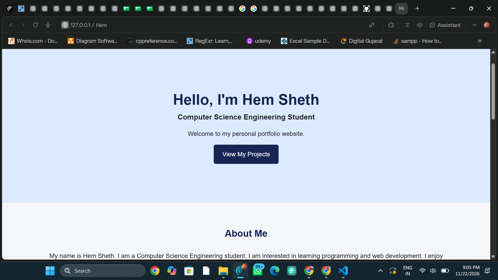
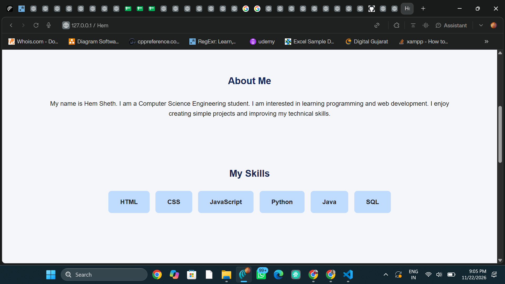
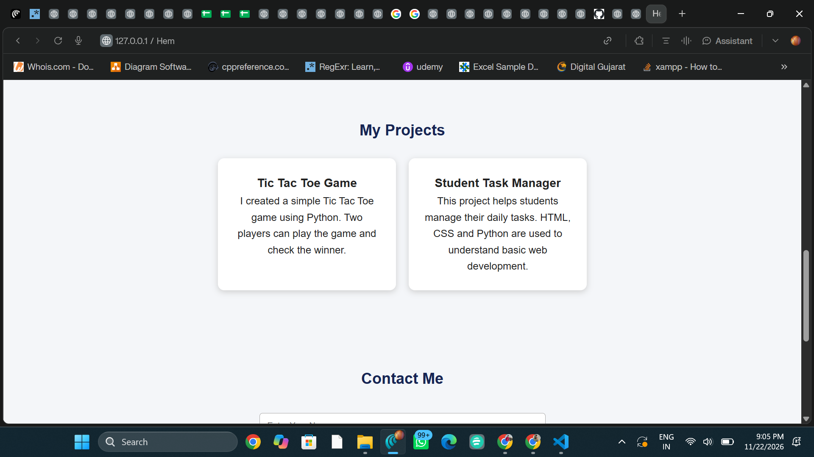

# Hem Sheth - Personal Portfolio

## About My Project
This is my personal portfolio website created as a
student project. It shows my introduction, skills,
projects and contact form.

## Technologies Used
- HTML
- CSS
- JavaScript

## Features
- Home and About Me section
- Skills section
- Two project examples
- Contact form with validation
- Dark mode
- Mobile responsive navigation

## Screenshot
Add your portfolio screenshot here.

## Home Page

## About Me

## My Projects

## Portfolio Screenshot
![Portfolio](portfolio.png

## How to Run
1. Download or clone this repository.
2. Open the folder in Visual Studio Code.
3. Open index.html using Live Server.
